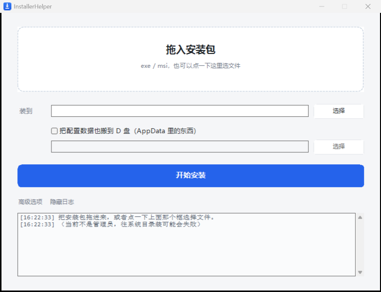

# InstallerHelper

把 Windows 软件装到你指定的目录，顺便把 AppData 里的配置数据也搬到别的盘。



## 它解决什么问题

很多安装包（尤其是 electron-builder 打的 NSIS 包）的安装界面里根本没有"选择安装目录"这一步，直接往 `C:\Users\<你>\AppData\Local\Programs` 塞。这个工具从命令行层面把目标目录传进去，装完再核对实际落在哪，不对就帮你迁过去。

## 快速开始

到 [Releases](https://github.com/emanon312/InstallerHelper/releases) 下载 `InstallerHelper.exe` 双击运行。

或者用源码版：双击 `Start-InstallerHelper.cmd`（PowerShell 5.1，Windows 自带）。

## 怎么用

1. 把安装包拖进上面的框（或者点框选文件），支持 exe / msi / msix
2. 目录自动填成 `D:\我的应用\<软件名>`，想改就改
3. 想把配置也搬走就勾上"把配置数据也搬到 D 盘"
4. 点"开始安装"

装完之后会自动找主程序建桌面 / 开始菜单快捷方式（可在"高级选项"里关）。安装器不听话装到了别处，会问你要不要迁回指定目录。

## 支持的安装器

| 类型 | 识别 | 指定目录 |
|---|---|---|
| NSIS | 支持 | `/S /D=<dir>` |
| Inno Setup | 支持 | `/VERYSILENT /DIR=<dir>` |
| MSI | 支持 | `msiexec /i /qn` + 读 INSTALLDIR 类属性 |
| InstallShield | 支持 | `/s /v"/qn INSTALLDIR=<dir>"` |
| WiX Bundle | 支持 | `/install /quiet` |
| MSIX / 7z SFX | 只识别 | 这类包没法指定目录，会直接告诉你 |

认不出来的包会明确告诉你，不会瞎装。

## 原理

**装到指定目录**：按安装器类型拼静默安装参数。装之前记下目标目录的文件数、字节数、最后写入时间，装完再比——变了就说明参数生效了。没变就去比对注册表卸载表的新增项，解析出真实安装位置，和你要的不一致就问要不要迁移。

**迁移到别的盘**：`robocopy` 把真实目录搬走，原位置用 `mklink /J` 建目录联接（junction）。软件按原路径读写，感知不到。卸载前记得先把链接还原成真实目录，否则卸载器可能连 D 盘的副本一起删。

**数据目录**：对比安装前后 `%APPDATA%` 和 `%LOCALAPPDATA%` 下的目录，按名字相似度打分，只有完全匹配才默认勾选。

## 已知限制

- 真机只测过 NSIS（orca）和 Inno Setup（anich）两类，MSI / InstallShield / WiX 走参数推断没实测
- 往 `C:\Program Files` 装需要管理员权限
- 数据迁移靠目录名相似度匹配，中文软件名可能匹配不上，得手动勾
- `%APPDATA%` 下的目录常在软件跑过一次后才出现，第一次没搬到就再点一次
- 迁移没有事务保证，中途断电要手动还原

## 文件

| 文件 | 作用 |
|---|---|
| `InstallerHelper.ps1` | 界面 |
| `helper-core.ps1` | 识别安装器 / 静默安装 / 目录迁移 |
| `Start-InstallerHelper.cmd` | 源码版启动器 |
| `InstallerHelper.exe` | 打包版（ps2exe 编译，162 KB） |
| `app.ico` | 图标 |

打包版运行时会把 `helper-core.ps1`、`app.ico`、`README.txt` 释放到 `%LOCALAPPDATA%\InstallerHelper`，配置和日志也放在那里。

## 重新打包

不需要 PowerShellGet，直接下 nupkg：

```powershell
Invoke-WebRequest 'https://www.powershellgallery.com/api/v2/package/ps2exe' -OutFile ps2exe.zip
Expand-Archive ps2exe.zip -DestinationPath .tools\ps2exe
Import-Module .\.tools\ps2exe\ps2exe.psd1 -Force

Invoke-PS2EXE -inputFile .\InstallerHelper.ps1 -outputFile .\InstallerHelper.exe `
  -noConsole -STA -x64 -iconFile .\app.ico `
  -title 'InstallerHelper' -description '把安装包装到指定目录，并把配置数据搬到 D 盘' `
  -product 'InstallerHelper' -company 'emanon312' -version '1.0.0.0' `
  -embedFiles @{
    '%LOCALAPPDATA%\InstallerHelper\helper-core.ps1' = '.\helper-core.ps1'
    '%LOCALAPPDATA%\InstallerHelper\app.ico'        = '.\app.ico'
    '%LOCALAPPDATA%\InstallerHelper\README.txt'     = '.\README.txt'
  }
```

注意：编译成 exe 后 `$PSScriptRoot` 是空的，所以 `InstallerHelper.ps1` 里做了回退——检测到 exe 模式就用 `%LOCALAPPDATA%\InstallerHelper` 当根目录。

## 许可

MIT
